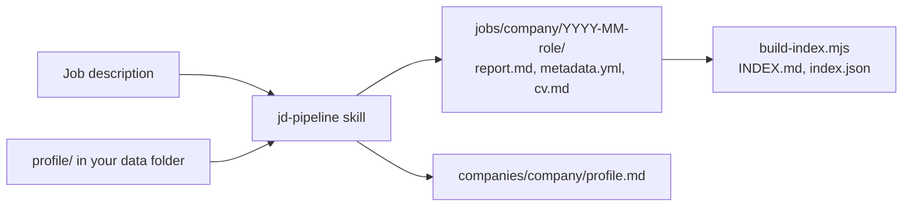

# rexcareer

> Job search workflows for AI coding agents. Analyse job descriptions, track
> applications, prepare for interviews, answer recruiters and review offers,
> with your data kept in your own private folder.

[](https://github.com/hoangbeard-labs/rexcareer/actions/workflows/ci.yml)
[](https://github.com/hoangbeard-labs/rexcareer/actions/workflows/security.yml)
[](LICENSE)

## Why

A job search produces a lot of scattered material: job descriptions, recruiter
chats, company research, CV versions, interview notes, offers. Chat assistants
forget it between sessions and score jobs against a vague idea of you.

rexcareer gives your agent a fixed method and a fixed place for everything:

- **Decision first.** Each job gets a short Decision Card with scores, risks and
  one recommendation.
- **Scored against you.** Fit comes from your verified work history and your
  own targets, never from a generic profile.
- **Honest by default.** Skills never invent experience and never copy
  confidential employer details into a CV.
- **Your data stays yours.** Tools live here; your data lives in a separate
  folder or private repo.

## What it does

| Ask your agent | Skill |
|---|---|
| "Analyze this JD" (link, file or text) | [`jd-pipeline`](skills/jd-pipeline.md) |
| "Research this company" | [`company-analysis`](skills/company-analysis.md) |
| "Is this salary fair?" | [`compensation-analysis`](skills/compensation-analysis.md) |
| "Compare these jobs" | [`compare-jobs`](skills/compare-jobs.md) |
| "Prepare me for the interview" | [`interview-prep`](skills/interview-prep.md) |
| "Reply to this recruiter" | [`recruiter-reply`](skills/recruiter-reply.md) |
| "Review this offer" | [`offer-review`](skills/offer-review.md) |
| "Add my last job to my history" | [`work-history`](skills/work-history.md) |

Supporting skills: [`job-evaluation`](skills/job-evaluation.md) and
[`career-prioritization`](skills/career-prioritization.md).

## Quick start

Requires Node.js 20.11 or later, and one of the supported agents.

```bash
git clone https://github.com/hoangbeard-labs/rexcareer.git
cd rexcareer

# Create your private data folder (or use a private git repo).
node scripts/init.mjs ~/career-data
export REXCAREER_DATA=~/career-data
```

1. Fill in `~/career-data/profile/career-profile.md`: target roles, role mix,
   language, pay.
2. Ask your agent to "add my work history" and answer its questions.
3. Paste a job description and say "analyze this JD".

Instead of `REXCAREER_DATA`, you can put the data folder (or a symlink to it)
at `./data`. It is ignored by git.

### Try the demo

`examples/demo-data` is a fictional security engineer with a finished job
analysis.

```bash
cp -R examples/demo-data /tmp/rexcareer-demo
export REXCAREER_DATA=/tmp/rexcareer-demo
```

Then ask: "analyze the JD in examples/jds/acme-fintech-cloud-security.md".

## Supported agents

`skills/` holds every workflow. `scripts/sync-wrappers.mjs` generates thin
wrappers that point to it.

| Agent | Reads |
|---|---|
| Claude Code | `CLAUDE.md` (imports `AGENTS.md`), `.claude/skills/` |
| Codex | `AGENTS.md`, `.agents/skills/` |
| Cursor | `AGENTS.md`, `.agents/skills/` |
| Kilo | `kilo.jsonc` (points to `AGENTS.md`), `.agents/skills/` |
| Oh My Pi | `AGENTS.md`, `.omp/skills/` |

## How it works



Your data folder:

```text
career-data/
├── profile/career-profile.md     # targets, role mix, language, pay
├── profile/work-history/*.md     # the only evidence source
├── companies/<company>/profile.md
├── jobs/<company>/YYYY-MM-<role>/
├── reports/
└── INDEX.md, index.json          # generated
```

Conventions are in [`AGENTS.md`](AGENTS.md). Output shapes are in
[`templates/`](templates/).

## Scripts

All scripts are plain Node.js with no dependencies.

| Command | Does |
|---|---|
| `node scripts/init.mjs <path>` | Create an empty data folder |
| `node scripts/data-root.mjs` | Print the data folder in use |
| `node scripts/next-job-id.mjs <YYYY>` | Next free job ID |
| `node scripts/build-index.mjs [--check]` | Rebuild or check the index |
| `node scripts/sync-wrappers.mjs [--check]` | Regenerate or check agent wrappers |
| `npm test` | Run the tests |

## Privacy notes

- Keep your data folder private. It holds CVs, pay and conversations.
- This repo never stores personal data. `examples/` is fictional.
- Agents send what they read to their model provider. Check your agent's data
  settings before you use it with real data.

## Roadmap

- [ ] CV export to PDF (planned in a separate web app)
- [ ] More languages for templates
- [ ] Job tracker views

## License

[MIT](LICENSE) © Pham Huy Hoang (HoangBeard)
