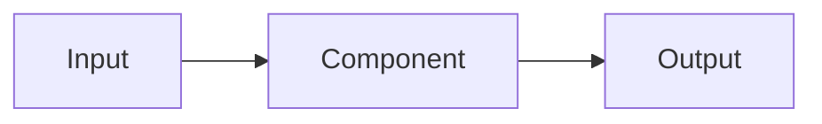

# PROJECT_NAME

> One sentence: what problem this solves and for whom.

[](https://github.com/OWNER/PROJECT_NAME/actions/workflows/security.yml)
[](https://scorecard.dev/viewer/?uri=github.com/OWNER/PROJECT_NAME)
[](LICENSE)

**English** · [Tiếng Việt](README.vi.md)

## Why

<!-- The problem, and why existing options fall short. -->

## Quick start

```bash
# Get from clone to a working result in under 5 minutes.
```

## Architecture



## Security notes

<!-- Threat model, hardening defaults, what NOT to use in production. -->

## Roadmap

- [ ] ...

## License

[MIT](LICENSE) © Pham Huy Hoang (HoangBeard)
