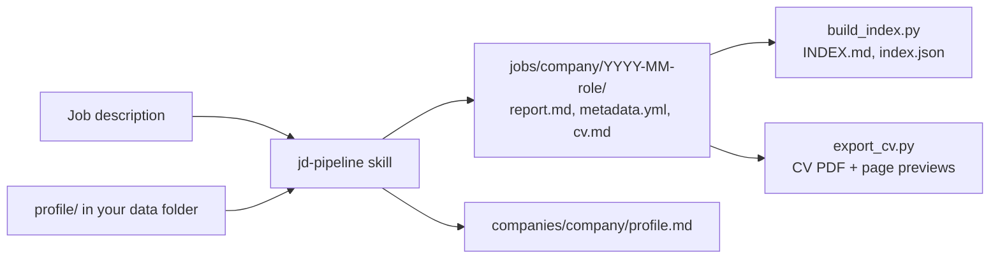

# career-intelligence

> Job search workflows for AI coding agents. Analyse job descriptions, track
> applications, prepare for interviews, answer recruiters and review offers,
> with your data kept in your own private folder.

[](https://github.com/hoangbeard/career-intelligence/actions/workflows/ci.yml)
[](https://github.com/hoangbeard/career-intelligence/actions/workflows/security.yml)
[](LICENSE)

## Why

A job search produces a lot of scattered material: job descriptions, recruiter
chats, company research, CV versions, interview notes, offers. Chat assistants
forget it between sessions and score jobs against a vague idea of you.

career-intelligence gives your agent a fixed method and a fixed place for everything:

- **Decision first.** Each job gets a short Decision Card with scores, risks and
  one recommendation.
- **Scored against you.** Fit comes from your verified work history and your
  own targets, never from a generic profile.
- **Honest by default.** Skills never invent experience and never copy
  confidential employer details into a CV.
- **Your data stays yours.** Tools live here; your data lives in a separate
  folder or private repo.

## What it does

| Ask your agent | Skill |
|---|---|
| "Set me up" (first run) | [`onboarding`](skills/onboarding.md) |
| "Analyze this JD" (link, file or text) | [`jd-pipeline`](skills/jd-pipeline.md) |
| "Research this company" | [`company-analysis`](skills/company-analysis.md) |
| "Is this salary fair?" | [`compensation-analysis`](skills/compensation-analysis.md) |
| "Compare these jobs" | [`compare-jobs`](skills/compare-jobs.md) |
| "Prepare me for the interview" | [`interview-prep`](skills/interview-prep.md) |
| "Reply to this recruiter" | [`recruiter-reply`](skills/recruiter-reply.md) |
| "Review this offer" | [`offer-review`](skills/offer-review.md) |
| "Add my last job to my history" | [`work-history`](skills/work-history.md) |
| "Export my CV to PDF" | [`export-cv`](skills/export-cv.md) |

Supporting skills: [`job-evaluation`](skills/job-evaluation.md) and
[`career-prioritization`](skills/career-prioritization.md).

## Quick start

You use career-intelligence through your own **private copy** of this repo (an
*instance*). Your data lives in its `data/` folder and is committed, so the
same job search opens on your laptop, in a cloud agent and on your phone.

Requires Python 3.10 or later, git, the GitHub CLI (`gh`, logged in) and one
of the supported agents. The CV export also needs the PDF tools: run
`scripts/setup-pdf.sh` once (it needs internet and takes about a minute).

```bash
git clone https://github.com/hoangbeard/career-intelligence.git
career-intelligence/scripts/create-instance.sh <your-github-user>/career
cd career
```

The script creates a private GitHub repo, copies the skeleton into it, adds a
`data/` folder, and keeps this repo as the `upstream` remote. GitHub does not
allow a private fork of a public repo, which is why it copies instead.

Then open your agent in that folder and:

1. Say **"set me up"**. The onboarding skill asks a few questions (language,
   target roles, role mix, pay) and builds your work history from your CV or
   from a short interview.
2. Paste a job link or description and say **"analyze this JD"**.

Every skill ends with `python3 scripts/save.py`, which commits and pushes your
data. The next session, on any device, starts with `scripts/doctor.py` and
shows your open jobs and their next steps.

To get new skills later:

```bash
git fetch upstream && git merge upstream/main
```

Only change files under `data/` in your instance. Put personal preferences in
`data/instructions.md`; then upstream merges never conflict.

### Try the demo

`examples/demo-data` is a fictional security engineer with a finished job
analysis.

```bash
cp -R examples/demo-data /tmp/career-intelligence-demo
export CAREER_INTELLIGENCE_DATA=/tmp/career-intelligence-demo
```

Then ask: "analyze the JD in examples/jds/acme-fintech-cloud-security.md".
The demo is for trying the skills; nothing is saved to git outside an instance.

## Supported agents

`skills/` holds every workflow. `scripts/sync_wrappers.py` generates thin
wrappers that point to it.

| Agent | Reads |
|---|---|
| Claude Code | `CLAUDE.md` (imports `AGENTS.md`), `.claude/skills/` |
| Codex | `AGENTS.md`, `.agents/skills/` |
| Cursor | `AGENTS.md`, `.agents/skills/` |
| Kilo | `kilo.jsonc` (points to `AGENTS.md`), `.agents/skills/` |
| Oh My Pi | `AGENTS.md`, `.omp/skills/` |

Tested end to end with Claude Code, Codex and Cursor, on a laptop and as cloud
agents. Kilo and Oh My Pi use the same files but are not tested yet.

Claude Code also runs `scripts/doctor.py` at every session start through
`.claude/settings.json`. Cursor runs it from `.cursor/environment.json`.

## Cloud agents and your phone

Work from anywhere with the same data. Setup:

**Claude Code on the web** (claude.ai/code, and the Code tab of the Claude
mobile app)

1. Install the Claude GitHub App on your private instance repo
   (github.com/apps/claude).
2. At claude.ai/code, create an environment for the repo with network access
   **Full**. Job sites are not on the default "Trusted" list, so job links
   would fail to load. "Custom" works too if you list your usual job sites.
3. Start a session on the repo and paste a job link. The session-start hook
   pulls your latest data; `save.py` pushes the result to `main`.
4. Back at your computer, `git pull`, or move the session to your terminal
   with `claude --teleport`.

**Cursor cloud agents**: enable cloud agents for the repo and allow internet
access for job sites. `.cursor/environment.json` runs the doctor on start.

Cloud agents sign commits with their own key or not at all. Do not turn on
"require signed commits" for your instance repo.

To export a CV to PDF in a cloud session, the agent runs
`scripts/setup-pdf.sh` once per environment. The PDF is committed with your
data, so you can open it from GitHub on your phone.

## How it works



Your data folder (`data/` in your instance):

```text
data/
├── profile/career-profile.md     # targets, role mix, language, pay
├── profile/work-history/*.md     # the only evidence source
├── companies/<company>/profile.md
├── jobs/<company>/YYYY-MM-<role>/
├── reports/
├── instructions.md               # optional: your lasting preferences
├── memory.md                     # optional: facts agents keep across sessions
└── INDEX.md, index.json          # generated
```

Conventions are in [`AGENTS.md`](AGENTS.md). Output shapes are in
[`templates/`](templates/).

## Scripts

All scripts are plain Python (3.10+) with no dependencies, except the CV
export, which uses the locked packages in `requirements-pdf.txt` and Chromium.

| Command | Does |
|---|---|
| `scripts/create-instance.sh <owner>/<repo>` | Create your private instance |
| `python3 scripts/doctor.py [--session-start]` | Setup check, open jobs, next steps |
| `python3 scripts/save.py "<message>"` | Commit and push `data/`, fixing index and ID clashes |
| `python3 scripts/migrate.py [--write]` | Upgrade an older data folder (dry run first) |
| `python3 scripts/renumber_job.py <job dir>` | Give a job a new ID |
| `python3 scripts/guard.py` | Fail if personal data is about to enter the skeleton |
| `python3 scripts/init.py <path>` | Create an empty data folder |
| `python3 scripts/data_root.py` | Print the data folder in use |
| `python3 scripts/next_job_id.py <YYYY>` | Next free job ID |
| `python3 scripts/build_index.py [--check]` | Rebuild or check the index |
| `python3 scripts/export_cv.py <job dir>` | Export the job's CV to PDF, with page previews |
| `scripts/setup-pdf.sh` | Install the PDF tools in `.venv/` (once per machine) |
| `python3 scripts/sync_wrappers.py [--check]` | Regenerate or check agent wrappers |
| `python3 -m unittest discover -s tests` | Run the tests |

## Privacy notes

- Keep your instance repo private. It holds CVs, pay and conversations.
- This repo never stores personal data. `examples/` is fictional, and
  `scripts/guard.py` (pre-commit and CI) refuses `data/` in the skeleton.
- Cloud agents copy your repo into their sandbox while they work. Use them
  only if you are fine with that provider seeing your data.
- Agents send what they read to their model provider. Check your agent's data
  settings before you use it with real data.

## Roadmap

- [ ] More languages for templates
- [ ] Job tracker views

## License

[MIT](LICENSE) © Pham Huy Hoang (HoangBeard)

The CV template embeds the Inter font by Rasmus Andersson, under the SIL Open
Font License 1.1 ([`scripts/cv/fonts/OFL.txt`](scripts/cv/fonts/OFL.txt)).
